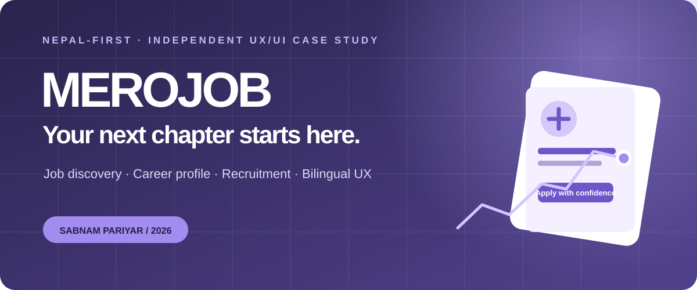

# MEROJOB — Your next chapter starts here.

*Explore an interactive Nepal-first employment experience, then visit its design system, moodboard and case study.*

*An independent UX / Product Design case study by Sabnam Pariyar.*

I designed this Merojob concept around a deeply human question: **how can finding a job feel less overwhelming, and more like taking a confident step toward the future?**

The prototype imagines a clearer employment journey for Nepal, connecting job discovery, saved opportunities, applications, career profiles and an employer workspace. Its bilingual English–Nepali experience, local city filters and Nepali rupee salary format make Nepal part of the actual interaction—not merely the visual decoration.

## Explore the experience

The working prototype is at the centre of this project. Search and filter fictional opportunities, apply to a sample role, advance an application through stages, update a career profile or try the employer shortlisting tools. Open the design system to explore both Latin and Devanagari typography, components, colors and moodboard references.

### The design challenge

A recruitment platform serves two groups with different needs: people seeking opportunity and the organizations reviewing their work. My guiding question was: **how can the interface give both sides enough context to make their next decision confidently?**

I focused on four principles:

- **Discover:** help candidates quickly identify relevant roles through location, skills and sector filters.
- **Understand:** present salary, work mode, requirements and company context without clutter.
- **Progress:** make application status understandable through a consistent stage-based journey.
- **Belong:** build bilingual, culturally aware experiences that feel natural for Nepali users.

## What you can try

1. Find a **Junior UX Designer** position in Kathmandu.
2. Filter opportunities by location and sector, then save a promising role.
3. Apply in demo mode and open **Applications** to inspect its progress.
4. Advance a sample application from Applied to Shortlisted, Interview and Offer.
5. Edit Asha Shrestha's fictional candidate profile and observe its completion score.
6. Switch to the **Employer** workspace and shortlist sample candidates.
7. Change language to **नेपाली**, and explore the **Design system** and **Case study** tabs.

All candidates, organizations, job listings and recruitment outcomes are fictional. No job application is transmitted.

## Behind the design

The design system combines Manrope and DM Sans with **Noto Sans Devanagari**, using a violet, ink and cloud palette. The moodboard references Himalayan horizons, Kathmandu, contemporary professional life and visual clarity. This is intentionally a modern Nepal-focused career product rather than a decorative tourism aesthetic.

Explore the written [UX case study](docs/UX-CASE-STUDY.md) and [design system specification](docs/DESIGN-SYSTEM.md) for the decisions and proposed validation work.

## Scope and honesty

Merojob is a real Nepali recruitment company. This project is an **independent, unofficial concept**, not commissioned, approved or endorsed by Merojob. Company names, vacancies, salaries, candidates and application outcomes in the prototype are invented. Moodboard photography is externally sourced inspiration. The research questions are proposals; no interviews, measured improvements or business results are claimed.

---

**Sabnam Pariyar** · UX / Product Design · Finland

